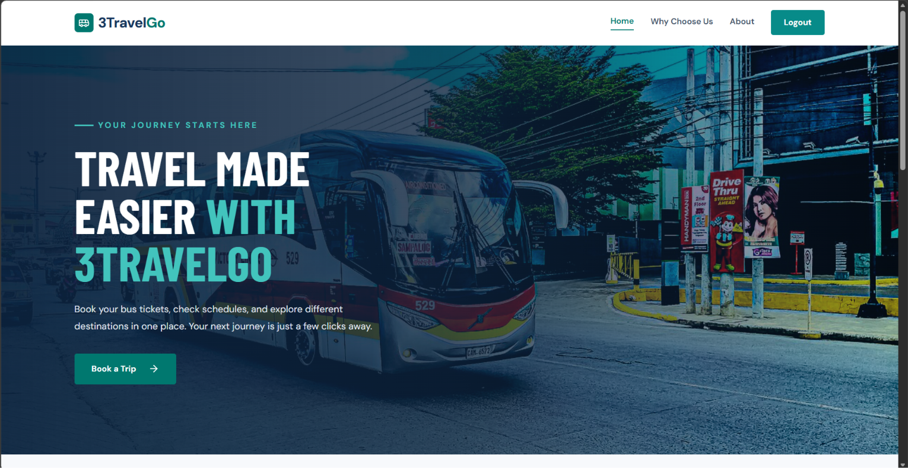

# 3TravelGo

<p align="left">
  
  
</p>

## Your Journey, Better Organized.

A web-based Bus Reservation Management System designed to make bus booking, trip scheduling, and transportation operations more organized.

<p align="left">
  
  
  
  
  
</p>

---

## Project Preview

<p align="center">
  
</p>

---

## About the Project

3TravelGo is a web-based bus reservation system that provides customers with a convenient way to explore bus trips and make reservations.

It also provides administrative and staff interfaces for managing reservations, trips, passengers, payments, and other transportation operations.

## System Modules

### Customer Portal
- Browse available bus trips
- View trip schedules and details
- Select bus seats
- Submit passenger information
- Make reservations
- View reservation and payment information

### Admin Portal
- Dashboard overview
- Manage bus trips
- Manage bus operators
- Manage terminals
- Manage seats
- Manage passengers
- Manage reservations
- Manage payments
- View reports

### Staff Portal
- Staff dashboard
- View reservations
- Monitor trip schedules
- Check seat availability
- Verify payments
- Scan passenger QR codes
- View check-in history
- Monitor trips

## Technologies Used

| Technology | Purpose |
|---|---|
| React | Frontend library |
| TypeScript | Frontend programming language |
| Tailwind CSS | Interface styling |
| Vite | Frontend development and build tool |
| PHP | Backend programming language |
| CodeIgniter 4 | Backend framework |
| PostgreSQL | Database management system |

## Project Structure

```text
3TravelGo-Bus-Reservation-System/
│
├── BACKEND/
│   ├── app/
│   ├── public/
│   ├── tests/
│   └── writable/
│
├── FRONTEND/
│   ├── public/
│   └── src/
│       ├── components/
│       ├── layouts/
│       ├── pages/
│       └── services/
│
├── docs/
│   └── 3travelgo-preview.png
│
└── README.md
```

## Installation Guide

### Requirements

- PHP
- Composer
- Node.js and npm
- PostgreSQL
- Git

### 1. Clone the Repository

```bash
git clone https://github.com/Syntaxdevv/3TravelGo-Bus-Reservation-System.git

cd 3TravelGo-Bus-Reservation-System
```

### 2. Backend Setup

```bash
cd BACKEND
composer install
php spark serve
```

Configure your CodeIgniter environment and PostgreSQL database connection before running the backend.

### 3. Frontend Setup

Open another terminal:

```bash
cd FRONTEND
npm install
npm run dev
```

Open the local development URL displayed by Vite.

## Database

3TravelGo uses PostgreSQL to store and manage application data, including:

- Bus operators
- Trips and schedules
- Terminals
- Seats
- Passengers
- Reservations
- Payments

## Repository

[GitHub – 3TravelGo Bus Reservation Management System](https://github.com/Syntaxdevv/3TravelGo-Bus-Reservation-System)

---

<p align="center">
  <strong>3TravelGo</strong><br>
  Making bus reservations more organized.
</p>